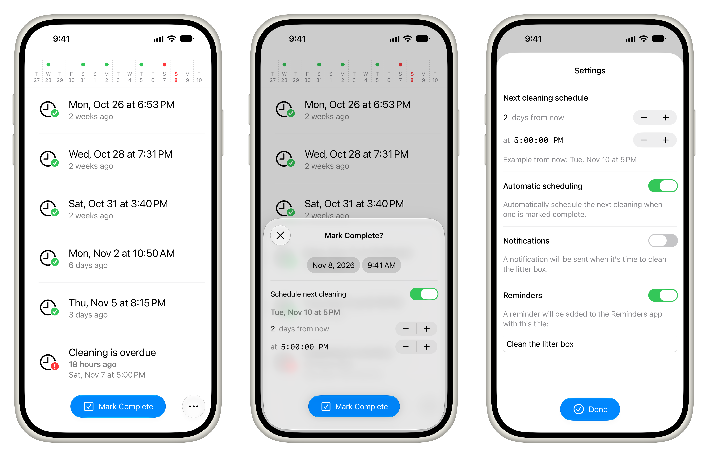

# LitterReminder

An app to schedule and track litter box cleanings. I actually use and rely on this app.

- Built with SwiftUI
- Uses SwiftData to persist data
- Uses CloudKit to sync the data
- Creates reminders using EventKit
- Creates local notifications

